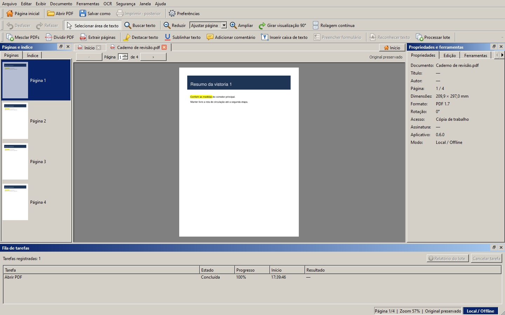

# Old School PDF

[](https://github.com/Reinaldo-Porfirio/old-school-pdf/releases/latest)
[](https://github.com/Reinaldo-Porfirio/old-school-pdf/actions/workflows/quality.yml)
[](LICENSE)


> Grátis para sempre. Sem assinatura, sem cadastro, sem nuvem. Você baixa e é seu.

Editor de PDF para Windows que funciona **sem internet**, com visual de software
dos anos 2000: relevo 3D, barras de título em degradê, ícones coloridos e menus
completos. Nada de minimalismo.



## ⬇️ Baixar

**[Página de downloads da versão mais recente](https://github.com/Reinaldo-Porfirio/old-school-pdf/releases/latest)**

| Arquivo | Para quem |
|---|---|
| [**OldSchoolPDF-0.6.0-setup.exe**](https://github.com/Reinaldo-Porfirio/old-school-pdf/releases/download/v0.6.0/OldSchoolPDF-0.6.0-setup.exe) (≈ 43 MB) | **Recomendado.** Instalador com atalhos e desinstalação. Não pede administrador. |
| [**OldSchoolPDF-0.6.0-sem-instalar.zip**](https://github.com/Reinaldo-Porfirio/old-school-pdf/releases/download/v0.6.0/OldSchoolPDF-0.6.0-sem-instalar.zip) (≈ 58 MB) | Para quem não quer instalar: extraia em qualquer pasta e abra `OldSchoolPDF.exe`. |

**Requisitos:** Windows 10 ou 11 de 64 bits e cerca de 130 MB livres em disco. Não precisa
de Python, de conta nem de internet. Foi testado no Windows 11. O Windows 10 é aceito,
mas ainda não foi testado.

> **"O Windows protegeu o computador"?** O instalador ainda não tem assinatura de
> código, então o SmartScreen avisa na primeira vez. Clique em **Mais informações >
> Executar assim mesmo**. Para conferir se o arquivo é o original, compare o
> SHA-256 com o publicado na [página da versão](https://github.com/Reinaldo-Porfirio/old-school-pdf/releases/latest)
> (no PowerShell: `Get-FileHash .\OldSchoolPDF-0.6.0-setup.exe`).

## O que ele faz

- **Ler:** abas, miniaturas, zoom, rolagem contínua, busca com acentos e cópia de texto.
- **Organizar:** mesclar, dividir, extrair, reordenar arrastando miniaturas, girar e excluir páginas.
- **Anotar:** destaque, sublinhado, comentários, caixas de texto, carimbos, formas e imagens.
- **Formulários:** preenche campos AcroForm compatíveis.
- **Converter:** imagens para PDF, PDF para PNG/JPEG, extração de texto e imagens, compactação e lotes.
- **OCR local:** torna pesquisáveis os PDFs digitalizados, em português e inglês ([veja como ativar](#ativar-o-ocr)).
- **Segurança:** senha AES-256, remoção de metadados, redação rasterizada, assinatura visual e
  assinatura digital com certificado PKCS#12, com verificação offline.
- **Sempre uma cópia:** o original nunca é sobrescrito. Desfazer e refazer percorrem as revisões.

Tudo é processado no seu computador. Nenhum arquivo é enviado para a internet.

## Instalar no Windows

Execute o `setup.exe`. O instalador:

- instala só para o seu usuário, sem pedir administrador (ou para todos, se preferir);
- cria atalhos no menu Iniciar e, se você quiser, na área de trabalho;
- pode colocar o Old School PDF em **Abrir com** para arquivos `.pdf`, sem trocar o seu leitor padrão;
- vem com tudo incluído, até a assinatura digital.

Para desinstalar, use **Configurações > Aplicativos > Old School PDF**. A desinstalação
remove programa, atalhos e associações. As preferências ficam em
`%LOCALAPPDATA%\Old School PDF` e não são apagadas.

Na versão **sem instalar**, basta apagar a pasta extraída.

## Ativar o OCR

O reconhecimento de texto usa o Tesseract, que já vem dentro do programa, mas os
**modelos de idioma são baixados à parte**:

1. Baixe [`por.traineddata`](https://github.com/tesseract-ocr/tessdata_fast/raw/4.1.0/por.traineddata)
   (português) e/ou [`eng.traineddata`](https://github.com/tesseract-ocr/tessdata_fast/raw/4.1.0/eng.traineddata)
   (inglês) do repositório oficial `tessdata_fast`.
2. Coloque os arquivos numa pasta, por exemplo `Documentos\tessdata`.
3. No programa, abra **OCR > Configurar OCR local…**, escolha a pasta e valide.

## Executar a partir do código-fonte

Para quem quer estudar ou modificar o código. Requer Windows x64,
[Git](https://git-scm.com/) e o [uv](https://docs.astral.sh/uv/), que pode ser instalado com
`winget install astral-sh.uv`. O uv baixa o Python certo (3.12 a 3.14) sozinho.

```powershell
git clone https://github.com/Reinaldo-Porfirio/old-school-pdf.git
cd old-school-pdf
uv sync --frozen --extra signing
uv run --no-sync python -m oldschoolpdf
```

Sem `--extra signing`, os comandos de assinatura digital ficam desabilitados. A
primeira instalação baixa Python e pacotes. Depois dela, o aplicativo funciona
offline. Também é possível abrir um PDF direto:

```powershell
uv run --no-sync python -m oldschoolpdf "D:\Documentos\Relatório.pdf"
```

Com Python já instalado, uma alternativa sem uv:

```powershell
py -3.13 -m venv .venv
.\.venv\Scripts\python.exe -m pip install -e ".[signing]"
.\.venv\Scripts\python.exe -m oldschoolpdf
```

Outras opções: `--settings-file C:\pasta\preferencias.ini` usa um arquivo de
preferências separado, e `--smoke-test` abre a janela, grava as preferências e fecha
sozinho, para diagnóstico.

## Ler e editar PDFs

- Use `Ctrl+O` ou solte PDFs locais na janela. Cada arquivo abre em uma aba e
  pede a senha na própria aba quando necessário.
- Clique em uma miniatura, informe a página ou pressione `Page Up` e `Page Down`.
  Use a lista de zoom, os botões de ajuste ou `Ctrl` com a roda do mouse.
- Abra a busca com `Ctrl+F`. Pressione `Enter` para procurar e navegue com `F3` e
  `Shift+F3`. A busca usa a camada de texto do documento.
- Arraste sobre o texto com a seleção por área ativada. `Ctrl+C` copia a área ou
  a página inteira quando o PDF permite cópia.
- Em **Documento**, mescle PDFs e revise a ordem e a contagem de páginas. Divida
  ou extraia intervalos como `2–4,6–8`. Arraste miniaturas para reordenar ou use
  o menu Documento para mover, girar e excluir páginas da cópia de trabalho.
- Em **Editar > Anotações** ou no painel **Edição**, escolha a ferramenta e
  indique a área na página. Selecione uma anotação para mover, editar o texto
  ou excluí-la conforme o tipo. O comando **Preencher formulário** lista os
  campos da página atual.
- **Ctrl+Z** e **Ctrl+Y** percorrem as revisões. **Ctrl+Shift+S** grava um PDF
  separado. Um asterisco indica alterações pendentes. A fila permite cancelar
  exportações antes da publicação.
- **Exibir > Rolagem contínua** permite percorrer várias páginas no mesmo painel.
- `F1` abre a ajuda local. A lista de atalhos está em **Ferramentas > Preferências**.

## Proteger, redigir e assinar cópias

- **Remover metadados** permite escolher campos da ficha Info e apagar o XMP
  completo. A operação preserva o conteúdo das páginas, campos e anexos.
- **Proteger cópia com senha** grava AES-256 com senhas distintas de abertura
  e proprietário. A autorização de proprietário é exigida para mudar a
  proteção ou os metadados de um PDF já criptografado.
- **Marcar área para redação** e **Exportar redação rasterizada** geram um PDF
  novo com páginas em imagens de 150 DPI. Revise todas as ocorrências visíveis
  antes de exportar. A cópia perde texto pesquisável, OCR, links, formulários
  e assinaturas. Aceita PDFs sem criptografia de até 100 páginas.
- **Inserir assinatura visual** coloca um desenho ou PNG/JPEG como anotação.
  A assinatura visual é uma marca gráfica sem verificação criptográfica.
- **Assinar digitalmente uma cópia** usa um certificado PKCS#12 local.
  **Verificar assinaturas digitais** mostra integridade, cobertura e confiança
  baseada nas raízes X.509 fornecidas. A avaliação é offline.

O INI de preferências fica em `%LOCALAPPDATA%\Old School PDF\settings.ini`. O
caminho efetivo aparece em **Ferramentas > Preferências > Local e privacidade**.
Ele guarda aparência, atalhos, organização da janela e limites de leitura. Página,
zoom e revisões ficam na sessão da aba. A gravação atômica exige a identificação do
Old School PDF em arquivos INI preexistentes e preserva outros arquivos indicados
por engano.

## Desenvolvimento e testes

Antes da suíte, defina `OLDSCHOOLPDF_TEST_TESSDATA` como a pasta que contém os
modelos `por.traineddata` e `eng.traineddata` se quiser executar o OCR real.
Sem essa variável, só os casos com reconhecimento real ficam de fora. O teste de
OCR indisponível continua ativo. Sem o extra `signing`, o caso com certificado
sintético é ignorado, e o teste de disponibilidade dos comandos continua ativo.

```powershell
uv sync --frozen --extra signing
uv run --no-sync ruff check .
uv run --no-sync ruff format --check .
$env:QT_QPA_PLATFORM = 'offscreen'
uv run --no-sync pytest -v
uv run --no-sync python -m build --no-isolation
```

`offscreen` serve para testes headless. Remova a variável para abrir a janela
normal: `Remove-Item Env:QT_QPA_PLATFORM -ErrorAction SilentlyContinue`.
Os testes usam arquivos temporários, não as preferências reais. A
[CI](https://github.com/Reinaldo-Porfirio/old-school-pdf/actions/workflows/quality.yml)
roda lint, testes e build no Windows com Python 3.12, 3.13 e 3.14 a cada envio.
Linux ainda não foi validado.

### Gerar o executável e o instalador

Requer o [Inno Setup 6](https://jrsoftware.org/isinfo.php) para a última etapa
(`winget install JRSoftware.InnoSetup`).

```powershell
uv sync --frozen --extra signing
uv run --no-sync python packaging/build.py
```

O script gera o ícone e as imagens do assistente a partir do logo, monta o
executável com PyInstaller em `dist/pyinstaller/OldSchoolPDF`, testa a abertura
do programa e o leitor de PDF empacotado e cria `dist/OldSchoolPDF-<versão>-setup.exe`.
Use `--sem-instalador` para parar no executável.

## Estrutura e documentação

- `src/oldschoolpdf/domain`: modelos e invariantes sem Qt.
- `src/oldschoolpdf/application`: contratos e serviços, sem widgets.
- `src/oldschoolpdf/infrastructure`: QSettings, inspeção local e processos PDF.
- `src/oldschoolpdf/ui`: janela, painéis, diálogos, tema e ícones SVG próprios.
- `packaging/`: lançador, especificação do PyInstaller, script do instalador, build e textos de licença incluídos no executável.
- [Conceitos visuais](docs/concepts/README.md) que deram origem ao tema Clássico 2000.
- [Arquitetura](docs/architecture.md), [decisões de projeto](docs/decisions),
  [plano de teste](docs/test_plan.md), [guia do usuário](docs/user_guide.md),
  [especificação](docs/product_spec.md) e [histórico de versões](CHANGELOG.md).

O projeto se chamava **DocForge Ultimate** até a versão 0.5.0. Os registros
históricos em `docs/decisions` mantêm o nome antigo.

## Licença

Código sob **AGPL-3.0-or-later**, com PyMuPDF pela opção AGPLv3. Você pode usar,
estudar, modificar e compartilhar. Quem distribuir versões modificadas, inclusive
como serviço em rede, precisa publicar o código delas sob a mesma licença.
Consulte [LICENSE](LICENSE) e os [avisos de terceiros](THIRD_PARTY_NOTICES.md).
