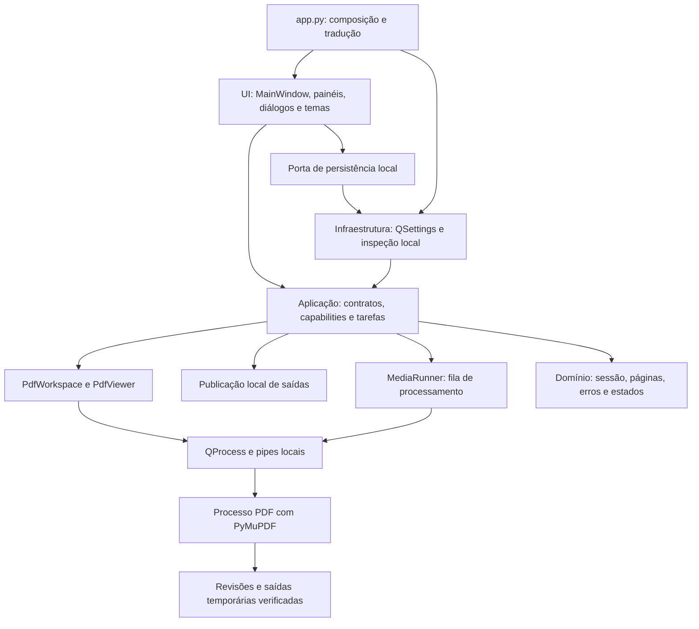
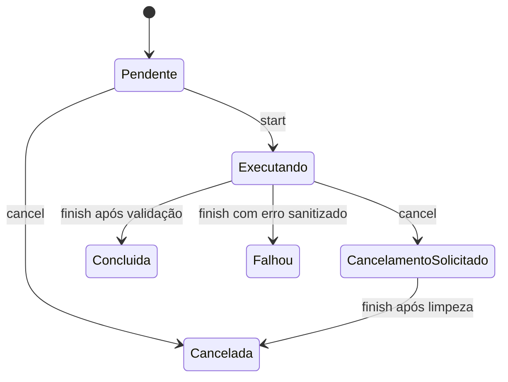

# Arquitetura do DocForge até M5

DocForge usa Python e Qt Widgets para a interface desktop. Cada documento
aberto tem um processo local de leitura e edição, gerenciado pela aplicação.

## Responsabilidades e dependências

| Camada | Arquivos principais | Responsabilidade |
|---|---|---|
| Composição | `app.py`, `__main__.py` | QApplication, locale pt-BR, QTranslator Qt, injeção dos adaptadores |
| Domínio | `domain/models.py`, `editing.py`, `tasks.py`, `errors.py` | Sessões, intervalos, anotações, campos e invariantes sem Qt ou I/O |
| Aplicação | `application/contracts.py` | Protocols de DocumentService, RenderService, JobService |
| Aplicação | `application/job_service.py` | Registro thread-safe, snapshots imutáveis, estados e cancelamento |
| Aplicação | `application/pdf_viewer.py`, `pdf_output.py` | Sessões, concorrência, cache, histórico e coordenação da publicação ou cancelamento |
| Aplicação | `application/media_runner.py` | Entradas sequenciais por lote, progresso, relatório e repetição de falhas |
| Aplicação | `application/capability_service.py` | Relatório distingue detectado, implementado e marco futuro |
| Infraestrutura | `infrastructure/dependency_probe.py` | Metadados via importlib.metadata e localização no PATH |
| Infraestrutura | `infrastructure/settings_repository.py` | INI, persistência de preferências e QByteArray do Qt, sync atômico |
| Infraestrutura | `infrastructure/pdf_process.py`, `pdf_worker.py`, `pdf_engine.py` | Transporte, prazos, autenticação e operações PDF |
| Infraestrutura | `infrastructure/pdf_editing.py`, `pdf_storage.py`, `local_files.py` | Mutação de revisões descartáveis, validação, históricos e publicação em unidade local |
| Infraestrutura | `infrastructure/pdf_ocr.py`, `pdf_media.py`, `media_output.py` | OCR, conversão, otimização e publicação isolada por entrada |
| Infraestrutura | `infrastructure/pdf_security.py`, `pdf_signatures.py` | Metadados, proteção, redação e assinatura/verificação locais |
| Interface | `ui/main_window.py`, `docks.py`, `document_tools.py`, `edit_dialogs.py` | Menus, painéis e confirmação de comandos de edição |
| Interface | `ui/themes.py`, `icons.py` | Paletas Fusion/QSS e ícones próprios desenhados por QPainter |
| Interface | `ui/pdf_tab.py`, `continuous.py` | Página individual, navegação contínua, seleção, busca e posicionamento |
| Interface | `ui/media_tools.py`, `media_dialogs.py`, `ocr_setup.py` | Entrada das tarefas, configuração opt-in e relatório |
| Interface | `ui/security_tools.py`, `security_dialogs.py` | Opções de proteção, marcas, desenho de assinatura e revisão de resultados |

O motor PyMuPDF é carregado no processo leitor. Os widgets recebem imagens,
metadados e retângulos por sinais. O domínio representa valores da sessão e
da leitura em Python puro.

QSettings é o adaptador concreto de persistência usado pela janela no M0; não se
introduziu uma abstração genérica de repositório sem segundo consumidor. Pode ser
substituído por um Protocol quando os serviços de preferências exigirem outro
backend. Arquivos INI de teste são injetados na composição.

## Sessão documental

`DocumentSession` representa a origem, o caminho da última cópia de trabalho e
o estado de alterações pendentes. `PdfViewer` guarda página, zoom, rotação
visual, busca e a revisão em cada aba. A numeração acompanha a ordem da revisão.

Os contratos síncronos do M0 foram preservados. No fluxo assíncrono do M1,
`PdfViewer` agenda operações e recebe respostas de `PdfProcess`. A imagem
em `ImageBuffer` chega como bytes RGB com dimensões verificadas. A aba converte
o raster para Qt e aplica a seleção e os realces por cima da página.

Para editar, o processo PDF lê a revisão atual, aplica o comando em outro
objeto do motor e grava um snapshot privado. A revisão muda após a validação.
Desfazer/refazer reabre o snapshot correspondente. Renderizações e miniaturas
em cache são invalidadas após a troca. Se o processo da aba falhar, a janela
pode reabrir a última revisão confirmada e iniciar um novo histórico.

## Tarefas

`JobRegistry` registra aberturas, buscas, exportações e lotes na memória da sessão. O visualizador
inicia o registro ao enviar uma operação, atualiza a busca conforme as páginas
são percorridas e conclui com o estado observado.

O cancelamento de abertura encerra o processo da aba. Na busca, o cancelamento
descarta a resposta da página em curso e interrompe o agendamento seguinte.
A fila mostra o estado cancelado. Exportação e edição têm prioridade sobre
renderização, cópia, inspeção dos objetos da página, páginas em rolagem,
miniaturas e busca. A mesclagem usa um processo dedicado. Ao cancelar exportação
da aba, o processo termina a operação corrente e a publicação é descartada.

O processamento M4 usa um processo separado por entrada e transmite progresso
pelo mesmo protocolo de pipes locais. A interface continua executando operações
do visualizador. Cada entrada tem diretório temporário próprio e é publicada por
renomeação depois da validação. Cancelar elimina a saída incompleta da entrada e
conserva resultados já publicados. A fila preserva estados e erros por tarefa.

## Persistência e segurança

QSettings em INI no AppConfigLocation, sem fallback para registro/outros escopos.
O INI guarda tema, ícones, estilo de texto, restauração de layout, atalhos
e limites do visualizador. Chaves ausentes nos INIs do M0 recebem padrões.
Layout: geometria e saveState com versão 1; objectName estável de cada dock/barra.
Dados desconhecidos ou malformados têm fallback seguro. Erros de escrita têm
mensagem e permitem tentar novamente, cancelar a saída ou sair explicitamente
sem salvar preferências. A área de trabalho pode ser restaurada pelo menu Exibir.
Um identificador interno distingue o INI do aplicativo de arquivos do usuário:
arquivos existentes sem essa identificação nunca são regravados, inclusive
quando fornecidos por engano em `--settings-file`. Não há exclusão automática de
configurações inválidas; um novo caminho permite iniciar com padrões.

O processo valida caminho local, extensão, tipo de arquivo e cabeçalho PDF.
A origem é aberta em leitura. A tela apresenta pixels e trata cliques como
gestos do aplicativo. O motor tem JavaScript desabilitado. A senha passa pelo
pipe local e o campo da aba é limpo no envio. Cópia e edição respeitam as
permissões do PDF.

No M5, o processo da aba recebe opções de segurança pelo pipe local.
Metadados, proteção, redação e assinatura criptográfica usam o mesmo estágio
validado e a mesma publicação do M2. A assinatura visual é uma anotação na
revisão de trabalho. Marcas de redação pertencem à aba e são apagadas quando
o histórico muda. A integração pyHanko é importada no processo PDF apenas
quando usada. Certificados e credenciais são escolhidos a cada operação e
o aplicativo não os grava nas preferências ou no registro da fila.

A exportação grava e sincroniza um temporário na pasta de destino. O processo
reabre a saída e confere sua estrutura, proteção e contagem. Após a validação,
a aplicação verifica cancelamento, identidade da origem e do destino e publica
o PDF. Substituir um destino existente exige confirmação e backup.

Detalhes do prazo, tamanho, cache e isolamento estão na decisão do M1.
[ADR 0002](decisions/0002-m1-viewer.md)

Políticas de edição, exportação e compatibilidade em M2 e M3.
[ADR 0003](decisions/0003-m2-m3-editing.md)

Escolha do motor OCR, modelos locais, conversões e limites de lote.
[ADR 0004](decisions/0004-m4-media.md)

## Interface e acessibilidade

Menus clássicos sempre presentes. Três barras móveis/ocultáveis, três docks
redimensionáveis/flutuantes, QTabWidget com abas fecháveis e reordenáveis.
Ajuda e diagnóstico são páginas locais. Os comandos da leitura acompanham a
aba ativa e os comandos dos próximos marcos indicam disponibilidade futura.
Dois temas Fusion com paleta completa, estados de foco,
nomes acessíveis e estado expresso em texto. Qt 6 fornece escalonamento DPI;
testes visuais em outras escalas/tecnologias assistivas permanecem necessários.

Toda string visível é pt-BR; widgets usam `tr` nos pontos principais e a composição
carrega a tradução Qt pt-BR. Um catálogo próprio de outro idioma ainda não foi
criado; preparar QTranslator não equivale a entregar interface em inglês.
